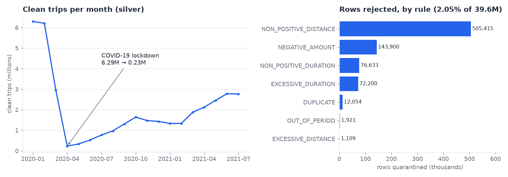

# TaxiLake: batch lakehouse on 39.6M NYC taxi trips

An end-to-end batch pipeline on real, messy public data. It downloads the NYC TLC yellow-taxi trip files, keeps a raw
copy, cleans them with explicit quality rules (bad rows are quarantined with a reason, never silently dropped),
and builds a tested star schema with dbt. Airflow orchestrates one run per month. Every step is idempotent: re-running
any month gives the same result.



## Results (measured on a 2-vCPU, 7 GB machine)

| | |
|---|---|
| Source | NYC TLC yellow trips, Jan 2020 – Jul 2021, 19 monthly CSV files (693 MB gzipped) |
| Rows ingested (bronze) | **39,649,199** |
| Rows clean (silver → gold) | **38,835,967** |
| Rows quarantined | **813,232 (2.05 %)** across 7 rules, incl. **12,054 exact duplicates** and **1,921 trips dated outside their file's month** (e.g. 2008 trips in the Jan-2021 file) |
| Reconciliation | bronze = silver + quarantine for all 19 months (checked in code); gold = silver row count and revenue ($717,702,437.91) for every month (dbt test) |
| dbt | 7 models + 4 seeds, **35 data tests**, 49/49 nodes pass |
| Bronze + silver, all months | 3 min 18 s |
| `fct_trips` full rebuild | 28 s |
| `fct_trips` reload of one month | **8 s** for a 2.7M-row month, **0.6 s** for a 230k-row month (delete+insert on `pickup_month`) |
| Re-running a month 3× | identical row count and revenue (idempotent) |
| Airflow | 1 month end-to-end in 61 s: bronze → silver → quality gate → dbt build |
| Python tests | 14 (one per quality rule, idempotency, atomic writes, lineage keys, DAG integrity, quality gate) |

## Architecture

```
TLC CSV.gz ──download──▶ landing/            (raw file, untouched)
                │
                ▼  typed schema, lineage cols (_source_file, _source_row, _ingested_at)
            bronze/yellow_trips/year=YYYY/month=MM/data.parquet      (every row)
                │
                ▼  9 rules, first failure wins
   ┌────────────┴─────────────┐
silver/…/data.parquet     quarantine/…/data.parquet  (+ reject_reason)
   │
   ▼  dbt (DuckDB)
gold: fct_trips (incremental) · dim_zone · dim_date · dim_vendor · dim_payment_type · dim_rate_code
      agg_daily_zone (dashboard table) · dq_quarantine_summary (quality scorecard)

Airflow DAG taxilake_monthly:  bronze ▶ silver ▶ quality_gate (fail if >5% rejected) ▶ dbt_build
```

## Quality rules (silver)

| Rule | Rows caught | Why it matters |
|---|---:|---|
| `NON_POSITIVE_DISTANCE` | 505,415 | Zero-mile trips are mostly cancelled or test rides; they distort fare per mile |
| `NEGATIVE_AMOUNT` | 143,900 | Refund and void rows; mixing them into revenue double-counts corrections |
| `NON_POSITIVE_DURATION` | 76,633 | Drop-off before or at pickup: clock errors |
| `EXCESSIVE_DURATION` (>12 h) | 72,200 | Meter left running |
| `DUPLICATE` | 12,054 | Same vendor, timestamps, zones, fare and total. All 12,054 are in the Jan-2020 file, which points to a one-off export problem upstream, not a pattern |
| `OUT_OF_PERIOD` | 1,921 | Trip date outside the file's month; would land in the wrong partition |
| `EXCESSIVE_DISTANCE` (>200 mi) | 1,109 | Odometer glitches |
| `MISSING_TIMESTAMP`, `UNKNOWN_ZONE` | 0 | Guard rails: present in tests, no hits in this data |

Kept but flagged: 98k+ rows per month with no vendor, payment type or passenger count (`is_partial_record`). They are
real trips with valid fares, so dropping them would understate revenue. The dimensions map missing codes to `-1 Not recorded`.

## Run it

```bash
python -m venv .venv && source .venv/bin/activate     # Python 3.12; on Windows use WSL for Airflow
pip install -r requirements.txt

python -m taxilake.cli run --months 2020-01:2021-07     # download + bronze + silver (~3.5 min)
cd dbt && DBT_PROFILES_DIR=. dbt build --full-refresh   # gold + 35 tests
DBT_PROFILES_DIR=. dbt build --vars '{months: ["2021-07-01"]}'   # reprocess one month
pytest -q                                               # from the project root

# Airflow (local)
pip install "apache-airflow==2.10.5" -c https://raw.githubusercontent.com/apache/airflow/constraints-2.10.5/constraints-3.12.txt
export AIRFLOW__CORE__DAGS_FOLDER=$PWD/dags AIRFLOW__CORE__LOAD_EXAMPLES=False
airflow db migrate && airflow dags test taxilake_monthly 2021-07-01
```

## Design decisions (and why)

- **DuckDB + Parquet instead of Spark.** 40M rows fit on one machine. DuckDB processes a 6.4M-row month in about 30 s
  on 2 vCPUs, with no cluster to run. Spark would make sense at roughly 100× this volume, or with many concurrent
  writers.
- **Declared raw schema.** Type inference on a 6M-row CSV is slow and can change between months, so the schema is
  written down instead.
- **Quarantine, not delete.** Each rejected row keeps its reason and lineage. When a rule changes, silver is rebuilt
  from bronze without re-downloading anything.
- **Atomic partition swap.** A month is written to a temp folder and renamed into place. A crash never leaves a
  half-written partition, and a re-run replaces the month instead of appending to it.
- **Delete+insert on `pickup_month`.** The reload unit is the month. Reprocessing a corrected month costs 8 s, not a
  28 s full rebuild, and its cost does not grow as history grows.
- **`max_active_runs=1`.** DuckDB allows one writer. Backfills run month by month.
- **Quality gate with `retries=0`.** A retry cannot fix bad source data, so a month with more than 5 % rejected rows
  stops before gold and waits for a human.
- **Stable `trip_key` = md5(file + row number).** TLC has no trip id. This key is deterministic across re-runs and
  points back to the exact raw line.

## Known limits

- **Local storage.** Moving to S3 means pointing `TAXILAKE_DATA_DIR` at object storage via DuckDB's `httpfs` and
  swapping the rename-based atomic write for a manifest or table format such as Iceberg. This has not been
  implemented here.
- **Airflow logical date.** `airflow dags test … 2021-07-01` processes **June** 2021: a `@monthly` run's data interval
  is the month *before* its logical date. This is correct Airflow behaviour, but it surprises people.
- **Fare components don't sum.** In about 27 % of rows the components do not add up to `total_amount`, because some
  fees are not in this file version. It is documented, not used as a reject rule.

## Interview questions this project prepares for

1. Why is bronze kept when silver already exists?
2. What exactly makes this pipeline idempotent, and how did you prove it?
3. Why delete+insert by month instead of `merge` on `trip_key`?
4. Why does partition pruning matter less here than you might expect? (Hint: most of the reload time is the delete.)
5. When would you move from DuckDB to Spark, and what would change?
6. A month suddenly has 9 % quarantined rows. Walk through what happens and what you do next.

## Data and license

Code: MIT ([LICENSE](LICENSE)). Data: [NYC TLC Trip Record Data](https://www.nyc.gov/site/tlc/about/tlc-trip-record-data.page), downloaded at run time under the City's terms of use.
